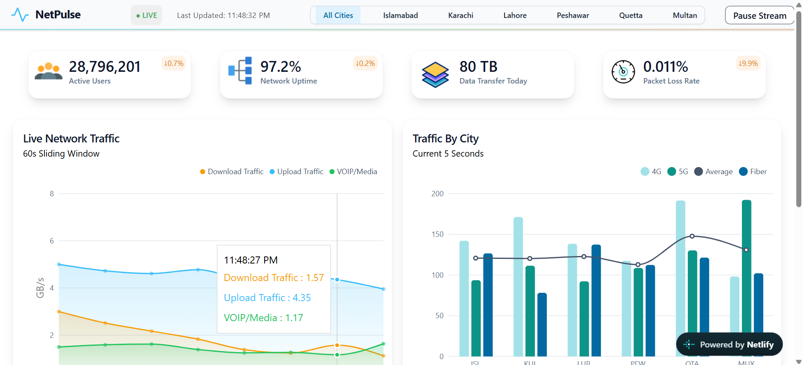

# NetPulse — Live Network Monitoring Dashboard

A responsive network monitoring dashboard that simulates real-time telecom network activity across major cities in Pakistan. NetPulse provides a visual overview of network performance, traffic statistics, tower health, and predictive network events.

## Project Links

- **Live Demo:** [View NetPulse](https://your-netpulse.netlify.app/)
- **GitHub Repository:** [NetPulse](https://github.com/Ayla-006/NetPulse)

## Key Features

- **Live Network Statistics:** Displays active users, network uptime, daily data transfer, and packet loss rate.
- **Live Traffic Monitoring:** Visualizes upload, download, and VoIP traffic.
- **City-Based Filtering:** Filter network information by Islamabad, Lahore, Peshawar, Multan, Karachi, and Quetta.
- **Traffic Analysis:** Compare 4G, 5G, and Fiber traffic across cities.
- **Predictive Network Events:** Displays simulated alerts, warnings, and informational events.
- **Tower Status Monitoring:** Shows tower conditions, including Active, Degraded, Down, and Planned.
- **Top Users:** Displays users with the highest data consumption.
- **Pause/Resume Stream:** Control the simulated live data stream.
- **Responsive Design:** Dashboard layout adapts to different screen sizes.

## Technologies Used

- React.js
- JavaScript
- Tailwind CSS
- Recharts
- Phosphor Icons
- Vite

## Dashboard Preview

## About Data

NetPulse currently uses randomly generated data to demonstrate live network monitoring functionality. It is not connected to real network APIs.

## Developer

**Ayla**

- GitHub: [@Ayla-006](https://github.com/Ayla-006)
